

<h1>
  
  VIN Sweep
</h1>

<h3>Vehicle Information & History at Your Fingertips</h3>

  A Flutter mobile application for VIN scanning, vehicle information lookup,
  report access, and payment and subscription management.

  
  
  
  
  

---

<h2>📌 Overview</h2>

  <strong>VIN Sweep</strong> is a Flutter-based mobile application designed
  to simplify vehicle information lookup through Vehicle Identification
  Number (VIN) scanning and manual entry.

  The application integrates with RESTful APIs to retrieve vehicle information,
  manage user accounts, generate PDF reports, and handle subscription plans
  and payments.

---

<h2>✨ Key Features</h2>

<h3>🔐 Authentication & Account Management</h3>

<ul>
  <li>User registration and login.</li>
  <li>Email verification using OTP.</li>
  <li>Forgot password and password reset.</li>
  <li>Session management.</li>
  <li>Secure local data storage.</li>
</ul>

<h3>🚘 VIN Scanning & Vehicle Lookup</h3>

<ul>
  <li>Real-time VIN scanning using the device camera.</li>
  <li>Text recognition powered by Google ML Kit.</li>
  <li>Automatic VIN text processing and validation.</li>
  <li>Manual VIN entry.</li>
  <li>Vehicle information retrieval through REST APIs.</li>
</ul>

<h3>📄 Vehicle Reports</h3>

<ul>
  <li>Access available vehicle reports.</li>
  <li>Purchase individual vehicle reports.</li>
  <li>Generate and retrieve PDF reports.</li>
  <li>View and manage report history.</li>
</ul>

<h3>💳 Payments & Subscriptions</h3>

<ul>
  <li>Stripe payment integration.</li>
  <li>Subscription plan management.</li>
  <li>Individual report purchases.</li>
  <li>Saved payment methods.</li>
  <li>Coupon validation and discount support.</li>
  <li>Payment history.</li>
</ul>

<h3>🏠 Dashboard & User Experience</h3>

<ul>
  <li>Interactive home dashboard.</li>
  <li>Scan history.</li>
  <li>Reusable UI components.</li>
  <li>Arabic and English localization.</li>
  <li>Responsive and user-friendly interfaces.</li>
</ul>

---

<h2 align="left">📱 Screenshots</h2>

  Explore the VIN Sweep application interface.

<table align="center">
  <tr>
    <td align="center">
      <strong>01. Splash Screen</strong>  
      
    </td>
    <td align="center">
      <strong>02. Onboarding</strong>  
      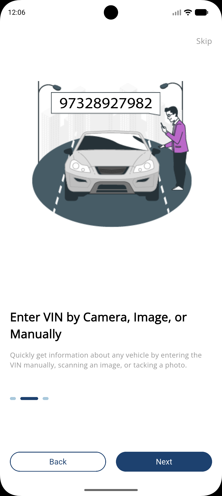
    </td>
    <td align="center">
      <strong>03. Login</strong>  
      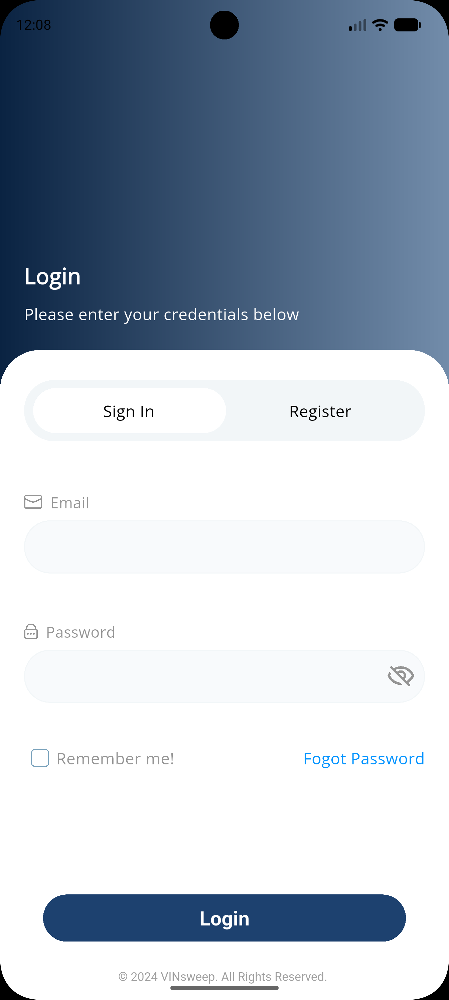
    </td>
    <td align="center">
      <strong>04. Registration</strong>  
      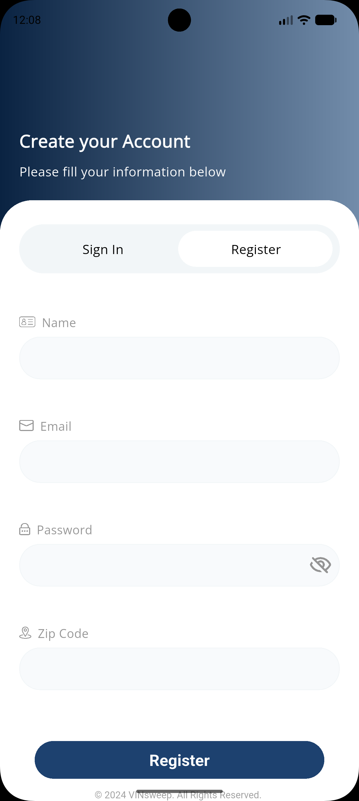
    </td>
    <td align="center">
      <strong>05. Email Verification</strong>  
      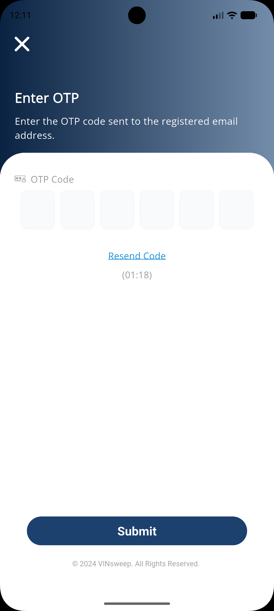
    </td>
  </tr>

  <tr>
    <td align="center">
      <strong>06. Home Dashboard</strong>  
      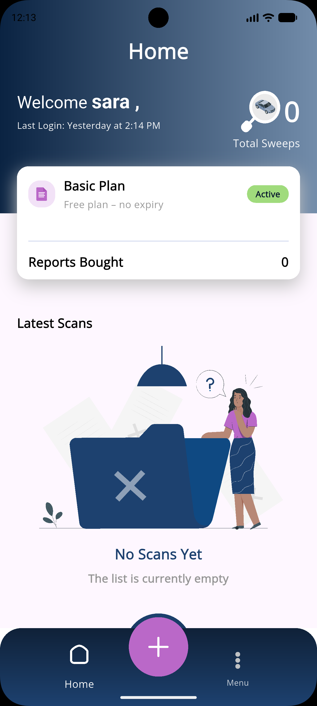
    </td>
    <td align="center">
      <strong>07. VIN Scanner</strong>  
      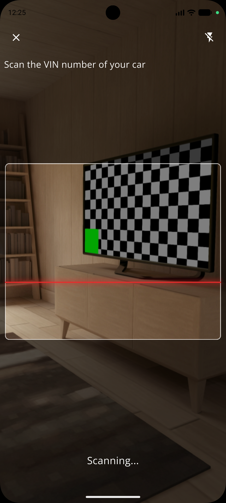
    </td>
    <td align="center">
      <strong>08. VIN Entry</strong>  
      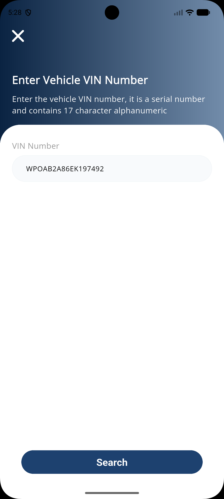
    </td>
    <td align="center">
      <strong>09. Vehicle Search</strong>  
      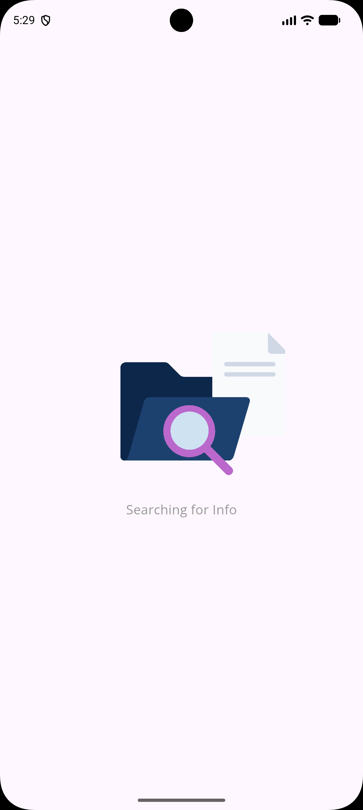
    </td>
    <td align="center">
      <strong>10. Vehicle Details</strong>  
      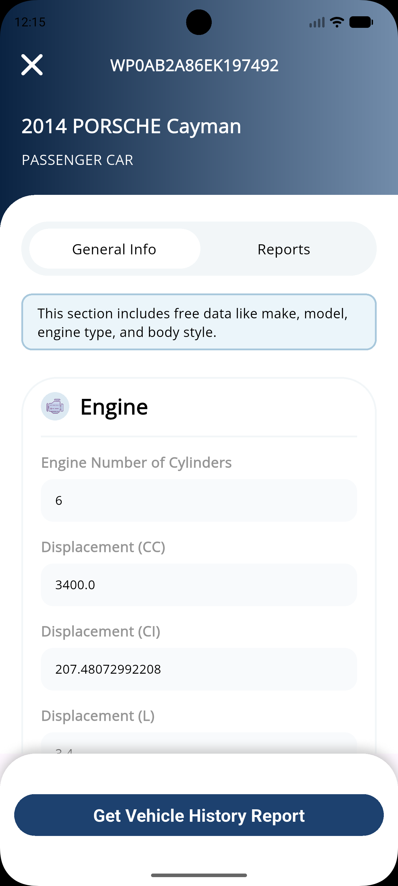
    </td>
  </tr>

  <tr>
    <td align="center">
      <strong>11. User Profile</strong>  
      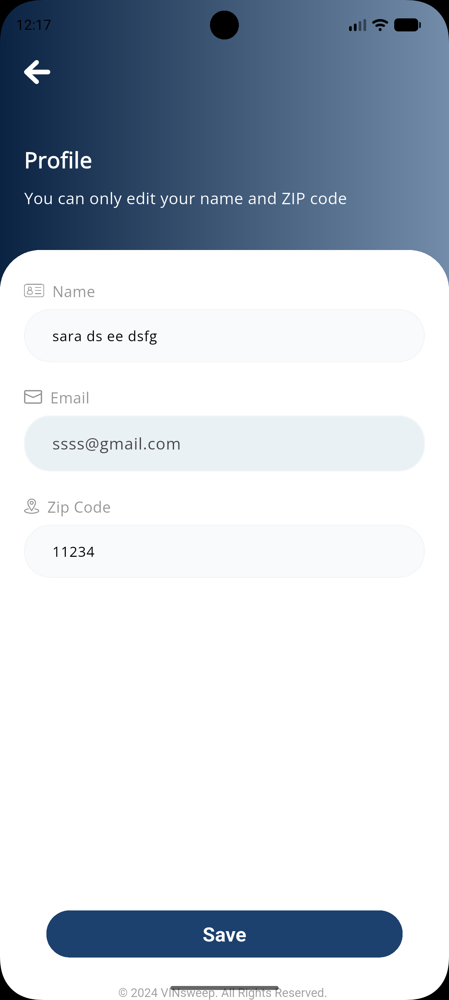
    </td>
    <td align="center">
      <strong>12. Subscription Plans</strong>  
      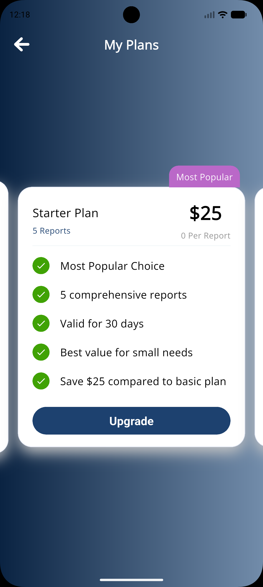
    </td>
    <td align="center">
      <strong>13. Payment Methods</strong>  
      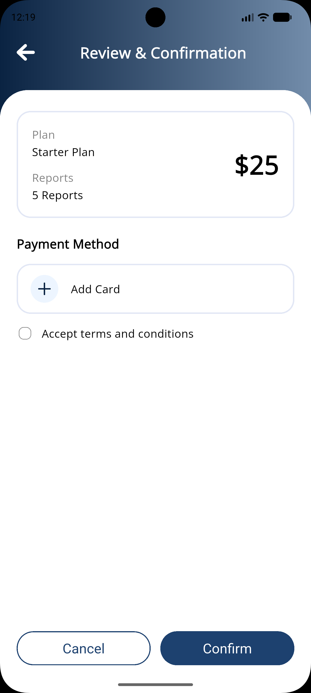
    </td>
    <td align="center">
      <strong>14. Add Cards</strong>  
      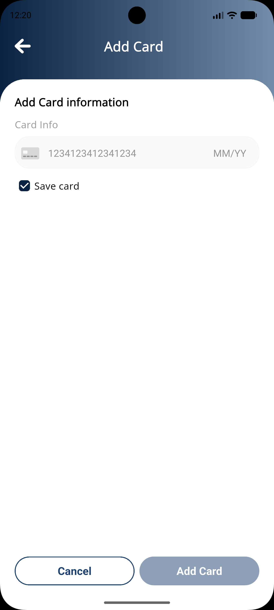
    </td>
    <td align="center">
      <strong>15. Payment</strong>  
      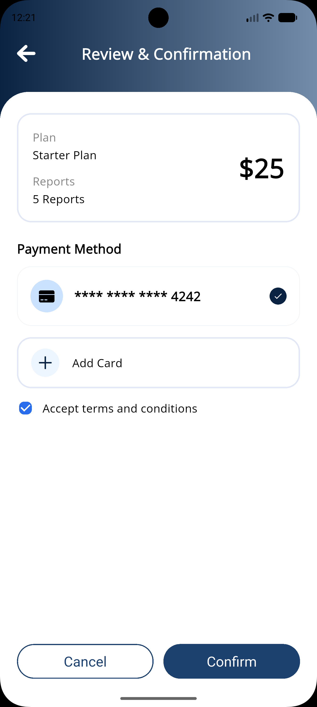
    </td>
  </tr>

  <tr>
    <td align="center">
      <strong>16. Success Payment</strong>  
      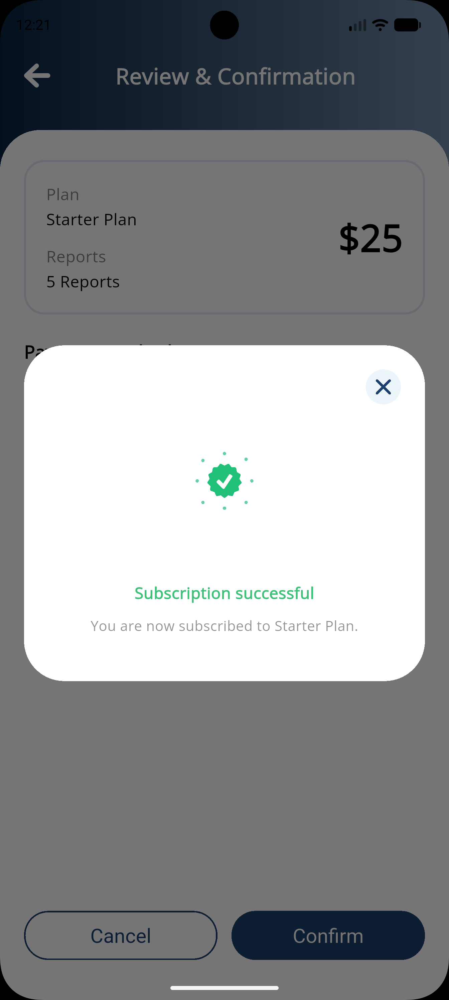
    </td>
    <td align="center">
      <strong>16. Plans Upgrade</strong>  
      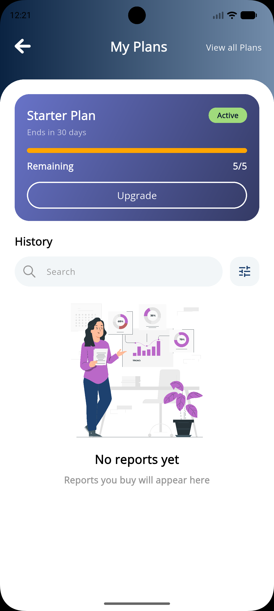
    </td>
    <td align="center">
      <strong>17. Home Upgrade</strong>  
      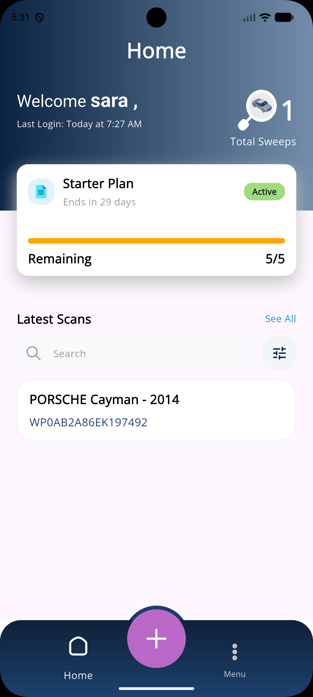
    </td>
    <td align="center">
      <strong>18. Menu</strong>  
      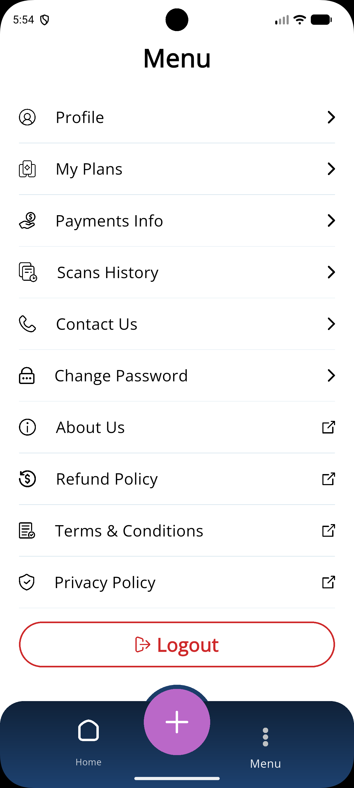
    </td>
    <td align="center">
      <strong>18. Bubble Button</strong>  
      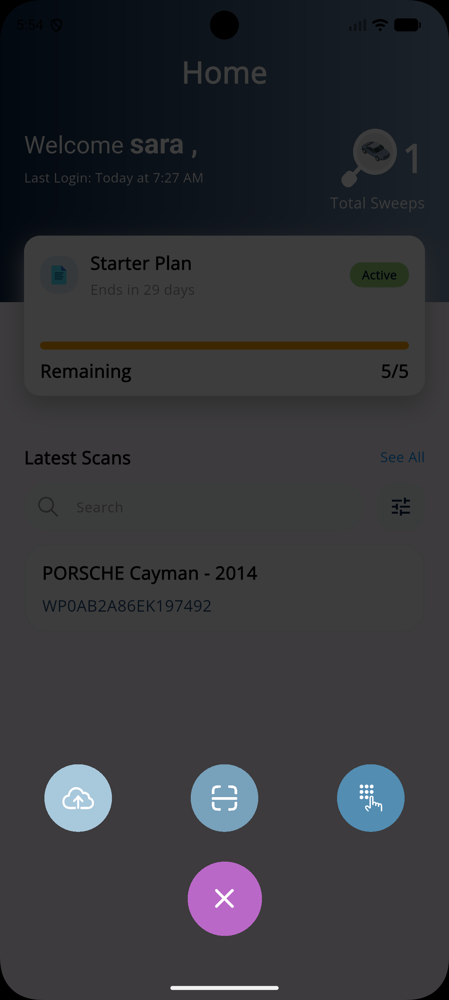
    </td>
  </tr>
</table>

---

<h2>🛠️ Technology Stack</h2>

<table>
  <tr>
    <th>Technology</th>
    <th>Purpose</th>
  </tr>
  <tr>
    <td>Flutter</td>
    <td>Cross-platform mobile development</td>
  </tr>
  <tr>
    <td>Dart</td>
    <td>Programming language</td>
  </tr>
  <tr>
    <td>GetX</td>
    <td>State management, dependency injection, and navigation</td>
  </tr>
  <tr>
    <td>REST APIs</td>
    <td>Backend communication</td>
  </tr>
  <tr>
    <td>Firebase Authentication</td>
    <td>User authentication</td>
  </tr>
  <tr>
    <td>Cloud Firestore</td>
    <td>Cloud database integration</td>
  </tr>
  <tr>
    <td>Google ML Kit</td>
    <td>Text recognition</td>
  </tr>
  <tr>
    <td>Camera</td>
    <td>Real-time VIN scanning</td>
  </tr>
  <tr>
    <td>Stripe</td>
    <td>Payment integration</td>
  </tr>
  <tr>
    <td>HTTP</td>
    <td>API communication</td>
  </tr>
  <tr>
    <td>Flutter Secure Storage</td>
    <td>Secure local storage</td>
  </tr>
  <tr>
    <td>Shared Preferences</td>
    <td>Local data persistence</td>
  </tr>
  <tr>
    <td>Git & GitHub</td>
    <td>Version control</td>
  </tr>
</table>

---

<h2>🏗️ Architecture</h2>

  The application follows a feature-based, MVC-inspired architecture
  combined with the Repository Pattern to ensure separation of concerns,
  maintainability, and code reusability.

<h3>Architectural Components</h3>

<table>
  <tr>
    <th>Component</th>
    <th>Responsibility</th>
  </tr>
  <tr>
    <td><strong>View</strong></td>
    <td>UI rendering and user interactions.</td>
  </tr>
  <tr>
    <td><strong>Controller</strong></td>
    <td>Business logic and reactive state management using GetX.</td>
  </tr>
  <tr>
    <td><strong>Model</strong></td>
    <td>Data representation and JSON serialization.</td>
  </tr>
  <tr>
    <td><strong>Repository</strong></td>
    <td>API communication and data operations.</td>
  </tr>
  <tr>
    <td><strong>Services & Helpers</strong></td>
    <td>Shared application functionality and utilities.</td>
  </tr>
</table>

<h3>Key Practices</h3>

<ul>
  <li>Feature-based project organization.</li>
  <li>Separation of UI and business logic.</li>
  <li>Repository Pattern for data access.</li>
  <li>GetX for reactive state management.</li>
  <li>Dependency injection and reusable components.</li>
  <li>Centralized HTTP handling and error management.</li>
</ul>

---

<h2>📂 Project Structure</h2>

<pre>
lib/
│
├── api/
│   └── system_config/
│
├── configuration/
│   ├── api_end_points.dart
│   ├── app_assets.dart
│   ├── app_colors.dart
│   ├── app_config.dart
│   ├── cache_keys.dart
│   └── current_session.dart
│
├── features/
│   ├── auth/
│   │   ├── login/
│   │   ├── register/
│   │   ├── otp/
│   │   └── forgot_password/
│   │
│   ├── coupon/
│   │
│   ├── FAB-menu/
│   │   ├── enter-vin/
│   │   ├── live-scan/
│   │   ├── scan-vin/
│   │   └── search-vehicle/
│   │
│   ├── home/
│   │   └── tabs/
│   │
│   ├── intro/
│   ├── plan-upgrade/
│   ├── reports/
│   └── splash/
│
├── generated/
├── l10n/
│
├── utils/
│   ├── helpers/
│   │   ├── common/
│   │   └── http/
│   ├── text-recognition/
│   └── ui/
│
└── main.dart
</pre>

---

<h2>🔌 API Integration</h2>

  VIN Sweep communicates with backend services through RESTful APIs.
  API operations are organized using repositories and a centralized
  HTTP wrapper.

<h3>Integrated API Modules</h3>

<ul>
  <li>Authentication and user management.</li>
  <li>Email verification and password recovery.</li>
  <li>Vehicle information lookup.</li>
  <li>VIN-related report operations.</li>
  <li>Subscription and plan management.</li>
  <li>Payment processing and payment methods.</li>
  <li>Coupon validation.</li>
</ul>

---

<h2>🔄 Application Flow</h2>

  <strong>Register / Login</strong>
  &nbsp; → &nbsp;
  <strong>Home Dashboard</strong>
  &nbsp; → &nbsp;
  <strong>Scan / Enter VIN</strong>
  &nbsp; → &nbsp;
  <strong>Vehicle Information</strong>
  &nbsp; → &nbsp;
  <strong>Vehicle Reports</strong>
  &nbsp; → &nbsp;
  <strong>Payment</strong>
  &nbsp; → &nbsp;
  <strong>PDF Report</strong>

---

<h2>🌍 Localization</h2>

  VIN Sweep supports multiple languages to provide an accessible
  user experience.

<ul>
  <li>🇬🇧 English</li>
  <li>🇯🇴 Arabic</li>
</ul>

  Localization is implemented using Flutter localization resources
  and ARB translation files.

---

<h2>🚀 Getting Started</h2>

<h3>Prerequisites</h3>

<ul>
  <li>Flutter SDK</li>
  <li>Dart SDK</li>
  <li>Android Studio</li>
  <li>Firebase project configuration</li>
  <li>Backend API access</li>
  <li>Stripe configuration</li>
</ul>

<h3>Installation</h3>

<strong>1. Clone the repository</strong>

<pre>
git clone git@github.com:S-Mistarihi/vin_sweep_application.git
</pre>

<strong>2. Navigate to the project directory</strong>

<pre>
cd vin_sweep_application
</pre>

<strong>3. Install dependencies</strong>

<pre>
flutter pub get
</pre>

<strong>4. Configure Firebase and application settings</strong>

  Add the required Firebase configuration files and configure
  the backend API and Stripe settings.

  Do not commit private API keys, payment secrets, or sensitive
  configuration files.

<strong>5. Run the application</strong>

<pre>
flutter run
</pre>

---

<h2>🔒 Security & Error Handling</h2>

<ul>
  <li>Secure local data storage.</li>
  <li>Input validation and VIN verification.</li>
  <li>Centralized API request handling.</li>
  <li>Structured repository results.</li>
  <li>API error handling and exception management.</li>
  <li>Separation of UI and business logic.</li>
</ul>

---
## 👤 Author
**Sara AL-Mistarihi**  

Junior Flutter Developer | Mobile App Developer   

---
